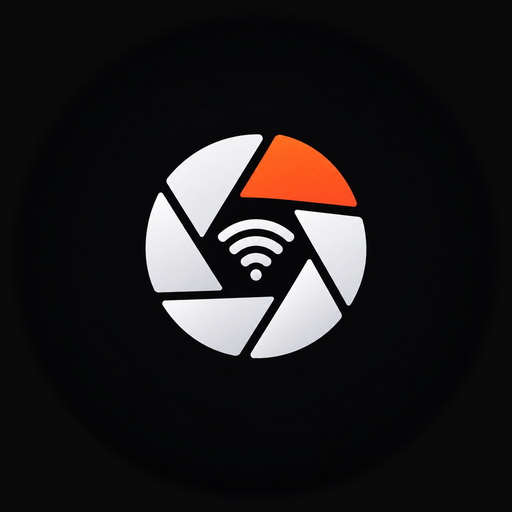

# SonnyLink

> 用 Android 手机通过 Wi-Fi 从老款索尼相机**导入照片**：浏览 · 放大预览 · 批量下载 · 本地相册。
>
> **轻量、安静、高效。** 专为 PMCA 时代（2015 前后）的索尼微单/黑卡设计。



---

## 免责声明

**这是第三方非官方软件，与索尼公司（Sony Corporation）无任何关联、未获其授权或认可。**

本项目通过分析相机公开的网络接口实现功能，仅供用户连接**自己拥有**的相机使用。
"SONY"、"ILCE" 等商标归其各自所有者所有。

---

## v2.0 照片导入版

v2.0 聚焦「照片导入」这一件事，**整体移除了实时取景 / 遥控拍摄**（相机在「发送到智能手机」
模式下才能提供 DLNA 相册服务，两种模式在固件层互斥）：

| | v1.x | v2.0 |
|---|---|---|
| 实时取景 / 遥控拍摄 | ✅ | ❌ 移除（约 -180KB 源码 / 两个模块） |
| 浏览卡内照片 | ✅ | ✅ |
| 未下载放大预览 | ❌ 仅网格缩略图 | ✅ 双指缩放 + 原图像素级查看 |
| 批量下载 | ✅ | ✅ 前台服务保活 + 失败重试 + 去重 |
| 本地相册 | ❌ | ✅ 按拍摄日期分组 · 分享 · 删除 |
| UI | 功能堆叠 | 设备 / 相册双 Tab，技术项全部收进设置页 |

---

## 功能

### 📱 设备页（相机卡内）

- **自动连接**：检测到相机热点（`DIRECT-xxxx:ILCE-xxxx`）后零操作直连
- **日期分组网格**：缩略图三级缓存（内存 LruCache → 磁盘 64MB LRU → 网络 10 路并发）
- **✓ 徽标**：已导入的照片一眼可辨（去重键 = 文件名 + 字节数，跨会话稳定）
- **多选批量下载**：3 路并发（可调 1/6/8），实时进度环

### 🔍 放大预览（未下载也能看）

- 进入预览自动加载 **LRG 大预览**（a6300 实测 1616×1080），双指捏合 / 双击缩放
- 点「加载原图」流式拉取完整 JPEG，切换到**区域解码视图**：
  只解码可见区域 —— 24MP 原图也能像素级看细节，内存占用与屏幕同阶（~几十 MB → ~3MB）
- RAW(.ARW) 只有转码预览（相机不提供原图，请求返回 HTTP 406），UI 明确标注
- 下载按钮前置展示原图大小

### 📥 导入

- **前台服务保活**：息屏 / 切后台不中断，系统通知显示进度
- **失败自动重试一次**（弱网断流是常态）
- **去重**：重复下载同一张自动跳过；已完成记录持久化（filesDir）
- RAW 的转码预览统一重命名为 `DSC00437_预览.jpg`（修复上游 MIME/扩展名不一致）
- 默认写入系统相册 `Pictures/SonnyLink`（IS_PENDING 保护，系统相册自动同步，免存储权限）

### 🖼 相册页（本机已导入）

- MediaStore 查询（**零权限**），ContentObserver 实时刷新（导入完成 1s 内出现）
- 按拍摄日期分组（DATE_TAKEN 由导入时从 EXIF 回填）
- 全屏查看器：区域解码缩放 · 系统分享 · 移至回收站（系统确认流）

### ⚙️ 设置（主界面零暴露）

- 下载并发 / 保存位置（SAF 自选目录，高级） / 诊断日志

---

## 性能

| 项 | 做法 | 效果 |
|---|---|---|
| 原图查看内存 | BitmapRegionDecoder **只解码可见区域**，量化去抖 | O(屏幕) 而非 O(原图)；24MP 约 3MB/帧 |
| 缩略图 | 内存 24MB LRU（重写 sizeOf）+ 磁盘 64MB LRU + 10 路并发 + 90ms 防抖 | 滚动顺滑、重进瞬时 |
| 下载 | 64KB 缓冲 + 3 路并发 + 500ms 测速采样（指数平滑） | 弱网总吞吐最优 |
| 保活 | 前台服务（dataSync）+ IS_PENDING 半成品启动清理 | 息屏不断、无半截文件 |
| 体积 | 移除取景/遥控代码 + R8 + 资源压缩 | ~2.5MB APK（持续优化） |

## 系统要求

- **Android 10（API 29）及以上**
- 相机需支持索尼 **Camera Remote API**（PMCA 时代机型），并有「发送到智能手机」应用
- 已验证：**Sony ILCE-6300 (a6300)** ✅；其他 ILCE / DSC / HDR 机型理论兼容，欢迎反馈

---

## 使用

1. 相机 → 菜单 → **应用程序** → **发送到智能手机**（保持该界面）
2. 手机系统设置里连接相机的 `DIRECT-xxxx:ILCE-xxxx` 热点
   （系统提示「无法访问互联网」是**正常的**，相机热点不提供上网）
3. 打开 SonnyLink → 自动检测连接 → 设备页浏览 / 多选下载
4. 导入完成后切到「相册」tab 查看 / 分享 / 删除

---

## 构建

需要 **JDK 17+**（任意较新 JDK 均可，项目显式输出 17 字节码）和 Android SDK（compileSdk 34）。

```bash
# 单元测试（core-dlna + core-import，共 82 个）
./gradlew :core-dlna:test :core-import:test

# Debug 包
./gradlew :app:assembleDebug
```

> Windows 中文用户名环境下建议设置 `GRADLE_USER_HOME` 为纯 ASCII 路径
> （如 `E:\gradle-home`），否则 Gradle 测试 worker 的 classpath 参数文件会损坏。

### 架构

```
core-dlna/       纯 Kotlin：SSDP / SOAP / DIDL-Lite / 分页浏览（含单测）
core-import/     纯 Kotlin：导入状态机 · 去重索引 · 测速（含单测）
app/
  camera/        CameraNetwork（句柄级网络绑定）· DlnaClient（DLNA 会话）
  device/        DeviceRepository · DeviceViewModel（浏览 / 缩略图缓存 / 多选）
  preview/       PreviewLoader（三级预览）· ZoomableImage · RegionZoomableImage · PreviewScreen
  import/        ImportManager（队列 + MediaStore/SAF 落盘）· ImportService（前台服务）
  album/         AlbumRepository · AlbumViewModel · AlbumScreen（含查看器）
  ui/            MainTabs（双 Tab）· DeviceScreen · ConnectScreen · SettingsScreen · 公共组件
  theme/         暗房（Darkroom）主题
```

## 已知限制（相机固件）

| 限制 | 说明 |
|---|---|
| **不能传 RAW 原文件** | 相机 DLNA 只提供转码 JPEG，请求 `.ARW` 返回 406；可下载转码预览 |
| **不能传视频** | `GetProtocolInfo` 只声明 JPEG |
| **取景固定 640×424**（v1 遗留说明） | 相机只提供这一个规格 |

---

## 许可

[MIT](LICENSE)

---

## 致谢

- 协议参考：[Sony Camera Remote API beta](https://developer.sony.com/) 公开文档
- 部分行为通过抓包与官方 App 对照验证
- 交互设计参考 DJI MIMO 的导入 / 相册逻辑
